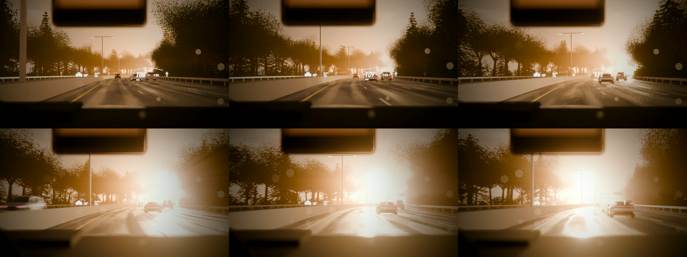

# car-driving

一个用 Blender 脚本程序化生成的 12 秒驾驶镜头：黄昏逆光的高速公路，车内第一人称视角，挡风玻璃上有 HUD，前方有几辆车并行。

A procedural 12-second dusk highway drive from the driver's seat, built entirely by one Blender Python script.



成片见 [Releases](../../releases)。

## 快速开始

需要 Blender 5.x（EEVEE）和 ffmpeg。

```sh
BLENDER=/Applications/Blender.app/Contents/MacOS/Blender ./render.sh 1080
```

`render.sh` 先用 `build_scene.py` 在空场景里建好全部内容，再渲染 288 帧（24 fps）。之后用 `audio/ambience.ffgraph` 合成环境音，输出 `output/car-driving_1080p24.mp4`。参数是输出高度，脚本默认 720p，传 1080 即放大到 150%。

只想在 Blender 里打开场景调参：

```sh
blender --factory-startup -P build_scene.py
```

## 目录

- `build_scene.py` 是唯一的场景源码。道路、护栏、路灯、龙门架、立交桥、1000 多棵树、HUD、车内、天空、体积雾、合成器，全部由它生成。文件开头的常量（太阳角度、雾浓度、曝光、弯道等）是主要的调节旋钮。
- `models/` 放三台车的 GLB（coupe、suv、sedan）。脚本导入后会自动拆出车轮做旋转动画。
- `audio/ambience.ffgraph` 是纯 ffmpeg 合成的环境音（路噪、风噪、引擎、三次超车呼啸），没有采样素材。
- `render.sh` 是渲染加混音的一键流程。
- `reference/` 是创作时参考的原视频抽帧（`source_sheet.jpg`）和生成车模用的截图。
- `docs/` 是成片的抽帧预览。

## 素材说明

- `models/` 中的车模由腾讯混元 3D 生成，使用时请遵守其服务条款。
- `reference/` 中的图片截自第三方视频，仅作创作参考，版权归原作者所有，不在本仓库许可范围内。
- 字体使用 macOS 自带的 DIN Alternate Bold。其他系统上找不到时会回退到 Blender 默认字体。

## 许可

代码（`build_scene.py`、`render.sh`、`audio/`）以 MIT 许可发布，见 [LICENSE](LICENSE)。
